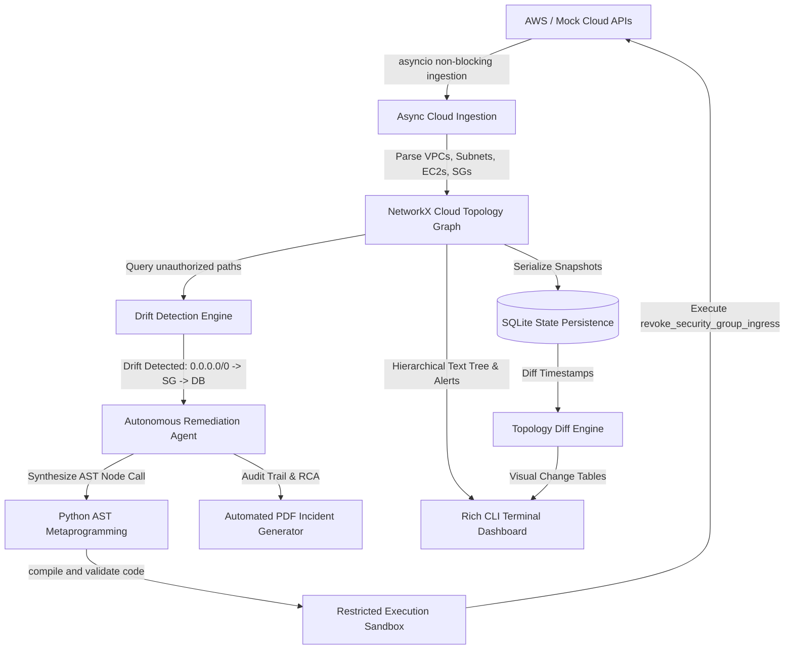

# AeroDrift: Agentic Cloud Topology & Remediation Graph

AeroDrift is an autonomous, agentic cloud operations (CloudOps) system built in Python. It continuously maps complex cloud infrastructure into an in-memory mathematical directed graph, detects unauthorized configuration drift (such as exposed databases) in real time, programmatically synthesizes rollback code using Python's `ast` (Abstract Syntax Tree) module, and executes autonomous self-healing in an isolated execution sandbox.

---

## 🏗️ Architecture & Core Components



---

## 📅 4-Week Milestone Breakdown

| Week | Target Focus | Key Technologies | Core Deliverables |
|---|---|---|---|
| **Week 1** | Cloud Ingestion & Graph Foundations | `asyncio`, `boto3`, `NetworkX` | Concurrent AWS API ingestion, Directed Graph modeling with resource containment & traffic edges. |
| **Week 2** | Drift Detection & CLI Dashboard | `NetworkX`, `rich.tree`, `rich.panel` | Shortest path security traversal queries (`0.0.0.0/0`), Rich hierarchical topology text-tree UI. |
| **Week 3** | Agentic Remediation & AST Synthesis | Python `ast`, Restricted `exec()` Sandbox | Dynamic rollback function synthesis, AST security validation, closed-loop self-healing in < 5 ms. |
| **Week 4** | State Persistence & Automated Reporting | `sqlite3`, `reportlab`, CLI flags | SQLite point-in-time snapshot persistence, graph diffing engine, and automated corporate PDF incident reports. |

---

## 🚀 Quickstart & CLI Commands

### 1. Run Autonomous Self-Healing Pipeline
```bash
python main.py
```
*Executes the full pipeline: establishes baseline, simulates drift, detects breach, synthesizes AST code, self-heals, validates baseline restoration, records SQLite snapshots, and exports an audit PDF report.*

### 2. View Historical Snapshots
```bash
python main.py --history
```

### 3. Diff Any Two Topology Snapshots
```bash
python main.py --diff 1 2
```

### 4. Run Unit Test Suite
```bash
python -m unittest discover tests
```

